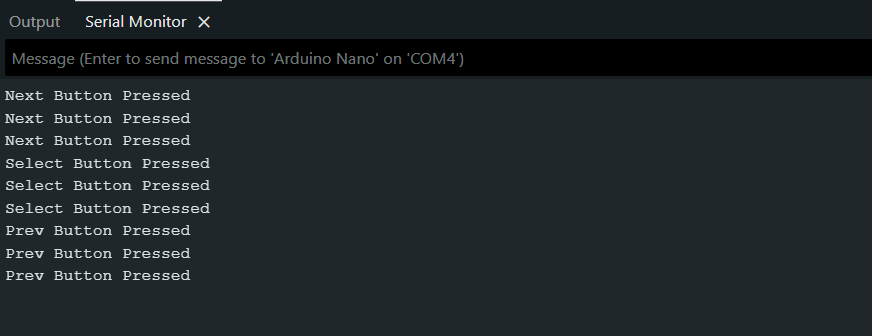
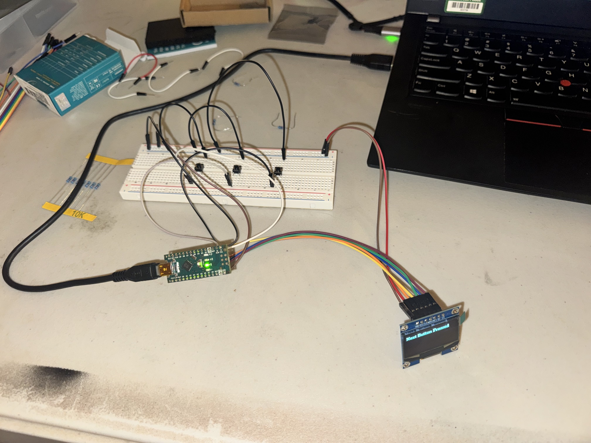

# MP3_Player
 
An MP3 player built from an Arduino Nano, a DFPlayer Mini, and an OLED display.
 
## Overview
 
This project is my first electronics build. I wanted to build something related to something I enjoy (music) that would also be useful.
 
## Goal
 
I built this to learn the basics of electronics: circuitry, soldering, debugging, and test automation. I hope to get my soldering down well enough to assemble it on a PCB small enough to be handheld.
 
Planned features:
- Turns on and off with a switch.
- Shows the track count on the display.
- Plays through headphones plugged into the audio jack. Pressing play starts the track.
- Skips to the next track without having to pause first.
- Lets me navigate the display to change the playback volume.
- Runs without being plugged in, using a battery connected to the charging module, and the charging module recharges the battery.
## Parts
 
### Main Components
 
| **Part** | **Qty** | **Purpose** | **Notes** |
| --- | --- | --- | --- |
| Arduino Nano | 1 | Main controller, used for speaking with the DFPlayer | Classic Nano |
| DFPlayer Mini MP3 Module | 1 | Audio playback module | |
| Micro SD card | 1 | Holds the songs and inserts into the DFPlayer | |
| 1.3" OLED Display (SH1106) | 1 | Display for songs and controls | 7-pin, SPI version |
| TP4056 Charging Module | 1 | Charge the battery pack and supply power to the build | |
| 3.7V Rechargeable Battery | 1 | Supplies power to the build | |
| 3.5mm Audio jack | 1 | Allows headphones for audio playback | PJ-320A, 4 pin |
| JST-PH 2.0 Male Connector Cable | 1 | Connect battery to charging module | |
| Push Buttons | 3 | Navigating the display, play/pause, volume up/down | |
| SPDT mini switch | 1 | Turning the power supply on/off | |
| MT3608 Boost Converter | 1 | Boosts the battery voltage to 5V to power the Arduino properly | |
 
### Other supplies needed
 
- 1k Ohm resistors
- 10uF capacitors
- PCB board
- Soldering iron
## Diagrams and Photos
 
**Schematic:** [MP3 Player schematic (PDF)](MP3_Player.pdf)
 
# Build Phases
 
## Phase 1: Navigation Buttons
 
**Objective:** Wire three push buttons to the Arduino Nano and print a line in the serial monitor each time a button is pressed.
 
**New parts:** Arduino Nano (classic), 3 push buttons, breadboard and jumper wires.
 
**Wiring:**
 
| Button | Nano pin |
|---|---|
| Prev | D2 |
| Select | D3 |
| Next | D4 |
 
Each button connects its Nano pin to GND.
 
**How it works:**
- All three pins use `INPUT_PULLUP`, so the Nano's internal pull-up resistor holds each pin HIGH when the button is not pressed. This removes the need for external pull-up resistors.
- Pressing a button connects the pin to ground, so it reads LOW. This is "active low": LOW means pressed.
- The sketch compares each pin's current reading to its previous reading. A change from HIGH to LOW counts as one press, and a line is printed to the serial monitor, for example `Select Button Pressed`.
**Serial monitor screenshot:** 
 
**Code:** [Sketch_MP3_Player.ino](Firmware/Sketch_MP3_Player.ino)
 
**Expected result:** Nothing prints while the buttons are untouched. One line prints per press, naming the button.
 
**Actual result:** A line prints in the serial monitor each time a button is pressed.
 
**Problems and fixes:**
- **Problem:** On startup, the serial monitor printed a press for all three buttons, even though nothing had been touched.
- **Cause:** The sketch assumed every button started HIGH. If a pin read LOW for an instant at power-up, the sketch saw a HIGH-to-LOW change and reported a press that never happened. One button (Prev) was also set to plain `INPUT` instead of `INPUT_PULLUP`.
- **Fix:** Set all three pins to `INPUT_PULLUP`, wait about 200 ms in `setup()` for the pins to settle, then read the real state of each pin as the starting value.
**Lessons learned:**
- Buttons wired to ground read LOW when pressed, which is the opposite of what you might expect.
- Initialize "previous state" variables from the real pin readings, not from an assumption.
- A pull-up resistor holds an input at a known HIGH level when the button is open, so the pin never "floats" between HIGH and LOW. The Nano has built-in pull-ups, `INPUT_PULLUP', that are enough for buttons, so no external resistor was needed for this phase.
---
 
## Phase 2: OLED Display (SH1106, SPI)
 
**Objective:** Wire a 1.3" SH1106 OLED display to the Nano over SPI and show a message on it. Then continue from Phase 1 so that pressing a button shows its name on the display instead of in the serial monitor.
 
**New parts:** 1.3" SH1106 OLED display module (7-pin, SPI version).
 
**Wiring:**
 
| OLED pin | Nano pin |
|---|---|
| CLK (labeled D0 on the module) | D13 |
| MOSI (labeled D1 on the module) | D11 |
| RES | A0 |
| DC | A1 |
| CS | A2 |
| VCC | 5V |
| GND | GND |
 
**Library and setup:** The sketch uses the U8g2 library with the software SPI constructor for this display:
 
```cpp
U8G2_SH1106_128X64_NONAME_F_4W_SW_SPI u8g2(U8G2_R0, 13, 11, A2, A1, A0);
```
 
The arguments are clock, data, CS, DC, and reset. Software SPI toggles the pins in code, so it works on any pins. Hardware SPI on the Nano is tied to D13 (clock) and D11 (data), which this build also uses, so I can switch to the hardware constructor later without rewiring.
 
**How it works:**
- First test: draw a short message on the display to confirm it works.
- Then combined with Phase 1: each time a button is pressed, the display clears and rewrites the button's name in the same place.
 
**Photo of the working display:** 
 
**Code:** [Sketch_MP3_Player_OLED.ino](Firmware/Sketch_MP3_Player_OLED.ino)
 
**Expected result:** The message appears on the display, and pressing a button updates it.
 
**Actual result:** The screen stays blank until a button is pressed. It then shows the button's name, and the screen is not cleared until a button is pressed again.
 
**Problems and fixes:**
- **Problem:** The display stayed blank after uploading. The Nano's L LED was blinking.
- **What the LED told me:** On the Nano, the L LED is connected to D13, which is also the SPI clock pin. Blinking meant the Nano was running the code and sending data to the display, so the problem was on the display side (wiring, pin numbers, or display configuration).
- **Checks done:** Confirmed the pins in the code matched the pins on the wires, and confirmed the display's SPI/I2C selection resistor was in the SPI position.
- **Cause:** The CLK and MOSI wires were swapped. The module labels these pins D0 and D1, which is easy to mix up.
- **Fix:** Swapped the two wires so CLK goes to D13 and MOSI goes to D11. The display worked right away.
**Lessons learned:**
- Check wires against the labels printed on the module, not against pin position, since the order differs between vendors.
- A blinking L LED during SPI use means the clock line is active, which helps separate software problems from wiring problems.
- Software SPI works on any pins but is slower than hardware SPI, which is fixed to D13 and D11 on the Nano. A text menu doesn't need the extra speed, but I can switch to the hardware constructor later for faster screen updates.
---
 
## Phase 3: Navigate on the Display
 
**Objective:** Use the three buttons to move through a menu on the display.
 
Coming soon.
 
---
 
## Phase 4: Power Switch
 
**Objective:** Add a switch to control power to the Nano.
 
Coming soon.
 
# Test Plan
 
Coming soon.
 
# Key Takeaways
 
Coming soon.